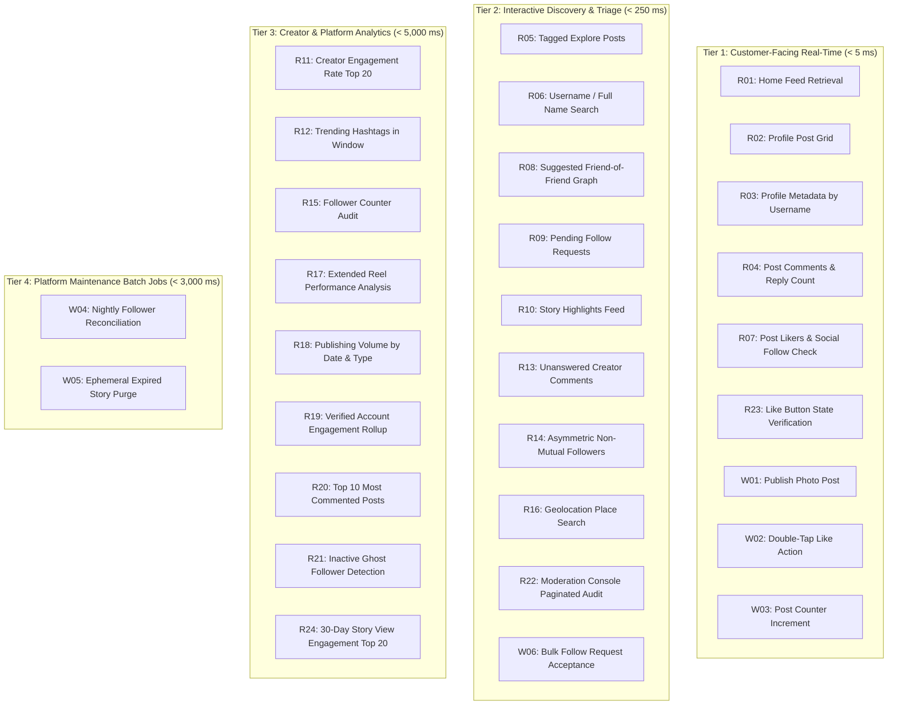

# Phase 1: Problem Understanding & Stakeholder Analysis

**Instagram Social Media Database (DBMS Project)**  
**Team:** T0145 · **Section:** A  
**Lead:** Anindya Sarkar | **Members:** Atharv Upadhyay, Badal Khandelwal, Anshika Srivastava  

---

## 1. Executive Summary

Instagram's core platform architecture is centered on a high-throughput social graph connecting accounts, media publications (photos, videos, carousels, reels), temporary ephemeral content (24-hour stories), and engagement interactions (likes, hierarchical comments, follow requests). The database currently operates without a formal relational schema specification, resulting in severe performance degradation across primary user journeys and critical backend processing pipelines.

This document systematically deconstructs the nine reported production bottlenecks (P1–P9), maps their business impact to respective stakeholder groups, classifies operational workloads into customer-facing real-time versus batch analytics tiers, and outlines core platform assumptions.

---

## 2. Problem Deconstruction (P1 – P9)

| # | Problem Reported | Primary Stakeholders | Classification | Associated Queries | Root Cause & Business Impact |
|---|---|---|---|---|---|
| **P1** | Slow Home Feed & Profile Grid for high-following users | End Users, Feed Engineering Team | Customer-Facing / Real-Time (< 5 ms target) | `R01`, `R02`, `R03` | Unindexed foreign keys on `follows` and `posts(user_id, created_at)` cause multi-table sequential scans when aggregating reverse-chronological feeds. Directly impairs user retention and app session initiation latency. |
| **P2** | Slow Viral Post Pages (comments, replies, like button states) | End Users, Content Consumers, Post Page Team | Customer-Facing / Real-Time (< 5 ms target) | `R04`, `R07`, `R23`, `W02`, `W03` | High concurrency lookups on viral post comments and likes suffer from unbounded scans across 420k+ likes and 150k+ comments. Real-time engagement checks (`EXISTS` on likes) stall during active traffic surges. |
| **P3** | High Latency in Explore & Search Type-Ahead | Search & Discovery Team, General Users | Interactive Search (< 250 ms target) | `R05`, `R06`, `R12`, `R16` | Case-insensitive prefix/substring pattern matching (`ILIKE '%karan%'`) on user entities and unindexed location filtering trigger full-table sequential sweeps, breaking real-time type-ahead expectations. |
| **P4** | Lag in Friend Recommendations & Pending Follow Requests | Social Graph Team, Private Account Users | Real-Time & Interactive (< 250 ms target) | `R08`, `R09`, `W06` | Two-hop friends-of-friends graph traversals (`f1 JOIN f2`) execute nested loop sequential joins. Private users waiting to triage pending follow requests experience lag due to missing `(followee_id, status)` indexes. |
| **P5** | Creator Insights & Audience Analytics Bottlenecks | Creator Ecosystem, Business Accounts | Reporting & Analytics (< 5,000 ms target) | `R11`, `R14`, `R17`, `R21` | Heavy aggregations calculating engagement rates, asymmetric follow relationships, video duration thresholds, and ghost followers require multi-table hash joins across full historical datasets without pre-aggregated summaries. |
| **P6** | Creator Tool "Comments Without Replies" Returning Empty | Creators, Community Management Team | Interactive / Diagnostic (< 250 ms target) | `R13` | Three-valued logic SQL defect: `NOT IN (SELECT parent_comment_id FROM comments)` evaluates to `UNKNOWN`/empty because `parent_comment_id` contains `NULL`s for all top-level comments. Requires query rewrite or filtering. |
| **P7** | Stored Profile Counters Drifting Out of Sync | Data Integrity Team, Platform Reliability | Batch Maintenance (< 3,000 ms target) | `R15`, `W04` | Asynchronous counter increments and incomplete atomic guarantees cause denormalized follower/like counts to drift. The corrective full-table join sweep (`W04`) is too slow for nocturnal execution windows without delta tracking. |
| **P8** | High Latency in Ephemeral Story Cleanup & Moderation Console | Trust & Safety Team, Ephemeral Media Team | Interactive & Batch (< 3,000 ms target) | `R10`, `R22`, `R24`, `W05` | Offset pagination on flagged comments (`OFFSET 1500`) scans and discards hundreds of pages. Large-scale bulk deletion of expired stories (`W05`) lacks partition pruning and index-driven range deletes. |
| **P9** | Analytics Query Timeouts Under 20× Anticipated Volume Growth | Growth Analytics, Executive Leadership | Complex Analytics (< 5,000 ms target) | `R18`, `R19`, `R20`, `W01` | Multi-dimensional grouping over high-cardinality event streams (posts, likes, comments by date/type) scales linearly or quadratically. The database requires architectural indexing, summary layers, and table partitioning. |

---

## 3. Workload Classification & Performance SLA Framework

To guide benchmarking and subsequent phase optimization, database operations are grouped into four operational tiers:

---

## 4. Key Architectural & Business Assumptions

1. **Social Graph Topology:** Follow connections are directional. If User A follows User B, User B does not automatically follow User A. Private accounts require explicit authorization (`status = 'PENDING' -> 'ACCEPTED'`), whereas public accounts transition directly to `'ACCEPTED'`. Self-following is strictly invalid.
2. **Denormalization Strategy:** Counters (`followers_count`, `following_count`, `like_count`, `comment_count`) are maintained as denormalized integers on parent tables (`users`, `posts`) for low-latency read rendering. Periodic reconciliation jobs (`W04`) correct asynchronous drift.
3. **Temporal Ephemerality:** Stories are ephemeral assets with an exact 24-hour lifetime lifecycle (`expires_at = created_at + INTERVAL '24 hours'`). Expired stories older than retention thresholds are safely purgable by background jobs (`W05`).
4. **Content Composition:** A post consists of 1 to 10 media assets (`post_media`). Single image/video posts have exactly 1 media record at position 1. Carousels must contain at least 2 media records ordered sequentially by `position`.
5. **Hierarchical Comments:** Comments support a single-level or multi-level threaded structure. A top-level comment has `parent_comment_id IS NULL`, while a reply references another valid `comment_id` belonging to the exact same `post_id`.
6. **Integrity Guarantees:** When a user or post is deleted, associated subordinate engagement records (`likes`, `comments`, `post_media`, `post_hashtags`) must cascade cleanly (`ON DELETE CASCADE`) to prevent orphaned records.
