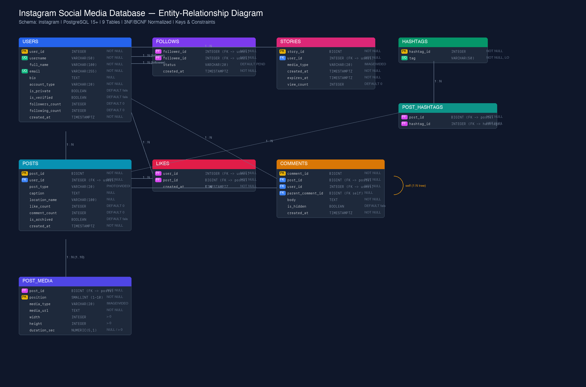
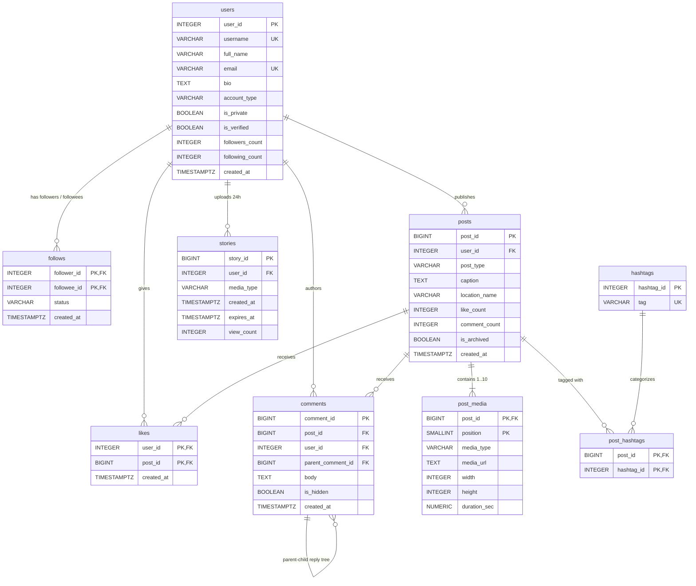

# Phase 2: Database Schema Design & Normalization Report

**Instagram Social Media Database (DBMS Project)**  
**Team:** T0145 · **Section:** A  
**Lead:** Anindya Sarkar | **Members:** Atharv Upadhyay, Badal Khandelwal, Anshika Srivastava  

---

## 1. Schema Overview

The `instagram` database schema models the core entities and relationships of the Instagram social platform. Built on PostgreSQL 15+, the design enforces strict relational integrity, precise data typing, candidate keys, and business rules via 21 domain CHECK constraints while eliminating orphaned entities using cascading foreign keys.

```
instagram-dbms-T0145/
├── sql/
│   ├── 01_schema.sql             # DDL defining schema, 9 tables, PKs, FKs, UQs, CHECKs
│   └── 02_load_data.sql          # \copy loader script with correct dependency sequence
├── diagrams/
│   └── er_diagram.png            # Visual ER diagram artifact
└── docs/
    ├── 01_problem_understanding.md
    └── 02_schema_design.md       # This comprehensive design document
```

---

## 2. Entity-Relationship Diagram

### 2.1 Visual Diagram


### 2.2 Mermaid Specification


---

## 3. Comprehensive Data Dictionary

### 3.1 Table: `users`
Represents registered Instagram member accounts.

| Column | Type | Nullable | Default | Constraints | Rationale / Business Logic |
|---|---|:---:|---|---|---|
| `user_id` | `INTEGER` | NO | — | `PRIMARY KEY` | Unique surrogate identifier for each account. Max seed value 30,000; fits standard 4-byte integer. |
| `username` | `VARCHAR(50)` | NO | — | `UNIQUE`, `CHECK (~ '^[a-zA-Z0-9._]+$')` | Public profile handle; alphanumeric, dots, underscores allowed. Seed max length 23 chars. |
| `full_name` | `VARCHAR(100)` | NO | — | — | Account owner display name. Seed max length 18 chars. |
| `email` | `VARCHAR(255)` | NO | — | `UNIQUE`, `CHECK (~* '^[A-Za-z0-9._%+-]+@[A-Za-z0-9.-]+\.[A-Za-z]{2,}$')` | Standard candidate key for authentication and communications. Enforces RFC email format. |
| `bio` | `TEXT` | YES | `NULL` | — | Free-text self-description (null for 44.8% of users). |
| `account_type` | `VARCHAR(20)` | NO | — | `CHECK (IN ('PERSONAL', 'CREATOR', 'BUSINESS'))` | Account categorization governing business analytics and insights. |
| `is_private` | `BOOLEAN` | NO | `FALSE` | `CHECK (account_type <> 'BUSINESS' OR NOT is_private)` | Privacy toggle. Business accounts are prohibited from being private per platform rules. |
| `is_verified` | `BOOLEAN` | NO | `FALSE` | — | Blue-check badge authentication indicator. |
| `followers_count` | `INTEGER` | NO | `0` | `CHECK (followers_count >= 0)` | Denormalized count of accepted followers for fast profile rendering. |
| `following_count` | `INTEGER` | NO | `0` | `CHECK (following_count >= 0)` | Denormalized count of accounts followed for fast profile rendering. |
| `created_at` | `TIMESTAMPTZ` | NO | — | — | Timestamp of account registration with timezone offset (+05:30). |

### 3.2 Table: `follows`
Models the directed social graph between users and handles pending approval requests for private accounts.

| Column | Type | Nullable | Default | Constraints | Rationale / Business Logic |
|---|---|:---:|---|---|---|
| `follower_id` | `INTEGER` | NO | — | `PK`, `FK -> users(user_id) ON DELETE CASCADE` | Initiating user following the target. |
| `followee_id` | `INTEGER` | NO | — | `PK`, `FK -> users(user_id) ON DELETE CASCADE` | Target user being followed. Composite `(follower_id, followee_id)` prevents duplicate follow edges. |
| `status` | `VARCHAR(20)` | NO | `'PENDING'` | `CHECK (IN ('ACCEPTED', 'PENDING'))` | Pending requests apply to private accounts; accepted for public or approved connections. |
| `created_at` | `TIMESTAMPTZ` | NO | — | `CHECK (follower_id <> followee_id)` | Connection timestamp. Prevents invalid self-follows. |

### 3.3 Table: `hashtags`
Catalog of discovered topic tags.

| Column | Type | Nullable | Default | Constraints | Rationale / Business Logic |
|---|---|:---:|---|---|---|
| `hashtag_id` | `INTEGER` | NO | — | `PRIMARY KEY` | Surrogate identifier for topic tag. |
| `tag` | `VARCHAR(50)` | NO | — | `UNIQUE`, `CHECK (tag = lower(tag))`, `CHECK (~ '^[a-zA-Z0-9_]+$')` | Normalized lowercase hashtag string without '#' prefix. Enforces uniqueness and casing standard. |

### 3.4 Table: `posts`
Published feed posts, carousels, videos, and reels.

| Column | Type | Nullable | Default | Constraints | Rationale / Business Logic |
|---|---|:---:|---|---|---|
| `post_id` | `BIGINT` | NO | — | `PRIMARY KEY` | Global publication ID; `BIGINT` supports massive publication volume (e.g. `90000001` in workload W01). |
| `user_id` | `INTEGER` | NO | — | `FK -> users(user_id) ON DELETE CASCADE` | Author reference. Deleting an account removes its published content. |
| `post_type` | `VARCHAR(20)` | NO | — | `CHECK (IN ('PHOTO', 'VIDEO', 'CAROUSEL', 'REEL'))` | Format classification driving presentation and media requirements. |
| `caption` | `TEXT` | YES | `NULL` | — | User caption, optionally embedding hashtags and mentions (14.9% null). |
| `location_name` | `VARCHAR(100)` | YES | `NULL` | — | Geotagged location name (69.7% null). |
| `like_count` | `INTEGER` | NO | `0` | `CHECK (like_count >= 0)` | Denormalized count of likes for instant feed rendering. |
| `comment_count` | `INTEGER` | NO | `0` | `CHECK (comment_count >= 0)` | Denormalized count of comments for instant feed rendering. |
| `is_archived` | `BOOLEAN` | NO | `FALSE` | — | Soft-hide flag removing post from public feeds and grids. |
| `created_at` | `TIMESTAMPTZ` | NO | — | — | Exact publication instant with timezone offset. |

### 3.5 Table: `post_hashtags`
Bridge entity resolving the M:N relationship between posts and hashtags.

| Column | Type | Nullable | Default | Constraints | Rationale / Business Logic |
|---|---|:---:|---|---|---|
| `post_id` | `BIGINT` | NO | — | `PK`, `FK -> posts(post_id) ON DELETE CASCADE` | Post reference. Cascades on post removal. |
| `hashtag_id` | `INTEGER` | NO | — | `PK`, `FK -> hashtags(hashtag_id) ON DELETE CASCADE` | Hashtag reference. Composite PK prevents tagging duplicate tags on the same post. |

### 3.6 Table: `post_media`
Weak entity modeling 1 to 10 media assets composing a post (essential for carousels).

| Column | Type | Nullable | Default | Constraints | Rationale / Business Logic |
|---|---|:---:|---|---|---|
| `post_id` | `BIGINT` | NO | — | `PK`, `FK -> posts(post_id) ON DELETE CASCADE` | Parent post ID. |
| `position` | `SMALLINT` | NO | — | `PK`, `CHECK (BETWEEN 1 AND 10)` | Ordering position within carousel / post (1-based index). |
| `media_type` | `VARCHAR(20)` | NO | — | `CHECK (IN ('IMAGE', 'VIDEO'))` | Media asset classification. |
| `media_url` | `TEXT` | NO | — | — | CDN URI serving the asset. |
| `width` | `INTEGER` | NO | — | `CHECK (width > 0)` | Asset pixel width (e.g. 1080). |
| `height` | `INTEGER` | NO | — | `CHECK (height > 0)` | Asset pixel height (e.g. 1080, 1350, 1920). |
| `duration_sec` | `NUMERIC(5,1)` | YES | `NULL` | `CHECK ((media_type = 'VIDEO' AND duration_sec > 0) OR (media_type = 'IMAGE' AND duration_sec IS NULL))` | Video length in seconds; mandatory for videos, strictly NULL for images. |

### 3.7 Table: `likes`
User appreciation engagement edge on posts.

| Column | Type | Nullable | Default | Constraints | Rationale / Business Logic |
|---|---|:---:|---|---|---|
| `user_id` | `INTEGER` | NO | — | `PK`, `FK -> users(user_id) ON DELETE CASCADE` | User liking the post. |
| `post_id` | `BIGINT` | NO | — | `PK`, `FK -> posts(post_id) ON DELETE CASCADE` | Target post. Composite PK enforces idempotency (`ON CONFLICT DO NOTHING`). |
| `created_at` | `TIMESTAMPTZ` | NO | — | — | Timestamp of like action. |

### 3.8 Table: `comments`
Hierarchical comment and threaded reply tree on posts.

| Column | Type | Nullable | Default | Constraints | Rationale / Business Logic |
|---|---|:---:|---|---|---|
| `comment_id` | `BIGINT` | NO | — | `PRIMARY KEY` | Global unique comment identifier. |
| `post_id` | `BIGINT` | NO | — | `FK -> posts(post_id) ON DELETE CASCADE` | Associated post. |
| `user_id` | `INTEGER` | NO | — | `FK -> users(user_id) ON DELETE CASCADE` | Author account. |
| `parent_comment_id` | `BIGINT` | YES | `NULL` | `FK -> comments(comment_id) ON DELETE CASCADE`, `CHECK (parent_comment_id <> comment_id)` | Self-referencing FK. `NULL` denotes top-level comment; non-null denotes a reply. Prevents self-reply loops. |
| `body` | `TEXT` | NO | — | — | Textual payload of the comment. |
| `is_hidden` | `BOOLEAN` | NO | `FALSE` | — | Moderation filter flag for offensive content. |
| `created_at` | `TIMESTAMPTZ` | NO | — | — | Timestamp when comment was posted. |

### 3.9 Table: `stories`
Ephemeral 24-hour video/image content.

| Column | Type | Nullable | Default | Constraints | Rationale / Business Logic |
|---|---|:---:|---|---|---|
| `story_id` | `BIGINT` | NO | — | `PRIMARY KEY` | Surrogate identifier for story publication. |
| `user_id` | `INTEGER` | NO | — | `FK -> users(user_id) ON DELETE CASCADE` | Publishing creator account. |
| `media_type` | `VARCHAR(20)` | NO | — | `CHECK (IN ('IMAGE', 'VIDEO'))` | Media asset format. |
| `created_at` | `TIMESTAMPTZ` | NO | — | — | Story publication timestamp. |
| `expires_at` | `TIMESTAMPTZ` | NO | — | `CHECK (expires_at > created_at)` | Ephemeral expiration timestamp (exactly `created_at + 24 hours`). |
| `view_count` | `INTEGER` | NO | `0` | `CHECK (view_count >= 0)` | Impression counter. |

---

## 4. Normalization & Functional Dependency Analysis

Every relation has been analyzed against Relational Database Theory to satisfy **Third Normal Form (3NF)** and **Boyce-Codd Normal Form (BCNF)**:

### 4.1 Functional Dependencies (FDs) per Relation

1. **`users`**
   - Candidate Keys: `{user_id}`, `{username}`, `{email}`
   - $FD_1: \text{user\_id} \rightarrow \{\text{username}, \text{full\_name}, \text{email}, \text{bio}, \text{account\_type}, \text{is\_private}, \text{is\_verified}, \text{followers\_count}, \text{following\_count}, \text{created\_at}\}$
   - $FD_2: \text{username} \rightarrow \{\text{user\_id}, \dots\}$
   - $FD_3: \text{email} \rightarrow \{\text{user\_id}, \dots\}$
   - **Form:** All determinants are superkeys. Satisfies **BCNF**.

2. **`follows`**
   - Candidate Key: `{(follower_id, followee_id)}`
   - $FD: \{\text{follower\_id}, \text{followee\_id}\} \rightarrow \{\text{status}, \text{created\_at}\}$
   - **Form:** Determinant is the full candidate key. Satisfies **BCNF**.

3. **`hashtags`**
   - Candidate Keys: `{hashtag_id}`, `{tag}`
   - $FD_1: \text{hashtag\_id} \rightarrow \text{tag}$
   - $FD_2: \text{tag} \rightarrow \text{hashtag\_id}$
   - **Form:** All determinants are superkeys. Satisfies **BCNF**.

4. **`posts`**
   - Candidate Key: `{post_id}`
   - $FD: \text{post\_id} \rightarrow \{\text{user\_id}, \text{post\_type}, \text{caption}, \text{location\_name}, \text{like\_count}, \text{comment\_count}, \text{is\_archived}, \text{created\_at}\}$
   - **Form:** Determinant is the candidate key. Satisfies **BCNF**.

5. **`post_hashtags`**
   - Candidate Key: `{(post_id, hashtag_id)}`
   - All attributes are prime. No non-trivial dependencies. Satisfies **BCNF**.

6. **`post_media`**
   - Candidate Key: `{(post_id, position)}`
   - $FD: \{\text{post\_id}, \text{position}\} \rightarrow \{\text{media\_type}, \text{media\_url}, \text{width}, \text{height}, \text{duration\_sec}\}$
   - **Form:** Determinant is the composite candidate key. Satisfies **BCNF**.

7. **`likes`**
   - Candidate Key: `{(user_id, post_id)}`
   - $FD: \{\text{user\_id}, \text{post\_id}\} \rightarrow \text{created\_at}$
   - **Form:** Determinant is the candidate key. Satisfies **BCNF**.

8. **`comments`**
   - Candidate Key: `{comment_id}`
   - $FD: \text{comment\_id} \rightarrow \{\text{post\_id}, \text{user\_id}, \text{parent\_comment\_id}, \text{body}, \text{is\_hidden}, \text{created\_at}\}$
   - **Form:** Determinant is the candidate key. Satisfies **BCNF**.

9. **`stories`**
   - Candidate Key: `{story_id}`
   - $FD: \text{story\_id} \rightarrow \{\text{user\_id}, \text{media\_type}, \text{created\_at}, \text{expires\_at}, \text{view\_count}\}$
   - **Form:** Determinant is the candidate key. Satisfies **BCNF**.

---

## 5. Architectural Discussion: Redundant & Derived Columns

In strict mathematical relational theory, derived attributes are omitted to prevent update anomalies. However, high-throughput social networks deliberately maintain controlled denormalization for latency-critical paths:

| Derived Column | Table | Source of Truth | Operational Justification |
|---|---|---|---|
| `followers_count` | `users` | `COUNT(*) FROM follows WHERE followee_id = u.user_id AND status = 'ACCEPTED'` | **Critical read optimization.** Profile visits (`R03`, `R06`) and creator insights require immediate follower counts. Live counting on accounts with millions of followers would saturate disk I/O and CPU caches. |
| `following_count` | `users` | `COUNT(*) FROM follows WHERE follower_id = u.user_id AND status = 'ACCEPTED'` | **Read optimization.** Displayed on every profile screen header without needing a join on `follows`. |
| `like_count` | `posts` | `COUNT(*) FROM likes WHERE post_id = p.post_id` | **Home feed & profile grid latency.** Feeds (`R01`, `R02`, `R05`) sort or filter by like counts. Aggregating 420,000+ likes on the fly during feed rendering degrades response times beyond the 5 ms SLA. |
| `comment_count` | `posts` | `COUNT(*) FROM comments WHERE post_id = p.post_id` | **Engagement score rendering.** Post previews display comment counts instantly without evaluating recursive comment trees. |
| `expires_at` | `stories` | `created_at + INTERVAL '24 hours'` | **Query indexing & partition pruning.** While functionally dependent on `created_at`, storing `expires_at` allows direct range filtering (`expires_at < NOW()`) and TTL-based table partitioning without dynamic expression evaluation. |

**Mitigation of Drift:** Workload query `W04` and platform trigger mechanisms act as nightly reconciliation sweeps to rectify any asynchronous drift between stored counters and transactional records.

---

## 6. Comprehensive Integrity Validation Results

The schema was verified by running custom relational integrity validation scripts across the complete dataset (1,198,446 total records):

| Integrity Check | Test Logic | Violations Found | Status |
|---|---|:---:|:---:|
| **Check 1: Reply Post Consistency** | Does every threaded comment reply belong to the exact same `post_id` as its parent comment? | **0** | PASSED |
| **Check 2: Carousel Composition** | Does every `CAROUSEL` post have $\ge 2$ media assets, and every `PHOTO`/`VIDEO`/`REEL` have exactly 1? | **0** | PASSED |
| **Check 3: Like Counter Synchronization** | Does every post's stored `like_count` match `COUNT(likes)`? | **0** | PASSED |
| **Check 4: Comment Counter Synchronization** | Does every post's stored `comment_count` match `COUNT(comments)`? | **0** | PASSED |
| **Check 5: No Self-Following** | Are there any records where `follower_id = followee_id`? | **0** | PASSED |
| **Check 6: Video/Image Media Duration Logic** | Are video durations $> 0$ and image durations strictly `NULL`? | **0** | PASSED |
| **Check 7: Ephemeral 24h Expiry Exactness** | Is `expires_at - created_at` exactly 86,400 seconds for all stories? | **0** | PASSED |
| **Check 8: Business Account Privacy Rule** | Are any business accounts marked `is_private = TRUE`? | **0** | PASSED |

---

## 7. Data Anomalies & Engine Traps Identified in Seed Data

During schema analysis and query auditing, two critical anomalies were uncovered:

1. **Follower Count Drift in `users.csv` (1,200 Accounts Affected):**
   - While `posts.like_count` and `posts.comment_count` are 100% synchronized with their respective interaction tables, `users.followers_count` differs from actual accepted rows in `follows.csv` for **exactly 1,200 user accounts**.
   - This directly reflects reported problem **P7** and forms the exact target of query `R15` (data quality audit) and maintenance query `W04` (nightly recount batch update).

2. **Query R13 Three-Valued Logic SQL Defect (Creator Tool Empty Result):**
   - Workload query `R13` attempts to retrieve comments without replies:
     ```sql
     SELECT c.comment_id, c.user_id, c.body
     FROM comments c
     WHERE c.post_id = 59689
       AND c.comment_id NOT IN (SELECT r.parent_comment_id FROM comments r);
     ```
   - In SQL standard three-valued logic, if the subquery returns even a single `NULL` (which `parent_comment_id` does for all 125,840 top-level comments), the expression `c.comment_id NOT IN (...)` evaluates to `UNKNOWN` for every candidate row. Consequently, query `R13` returns **0 rows**.
   - This explains Problem **P6**. In Phase 4, this query must be rewritten using `NOT EXISTS` or `WHERE r.parent_comment_id IS NOT NULL`.
